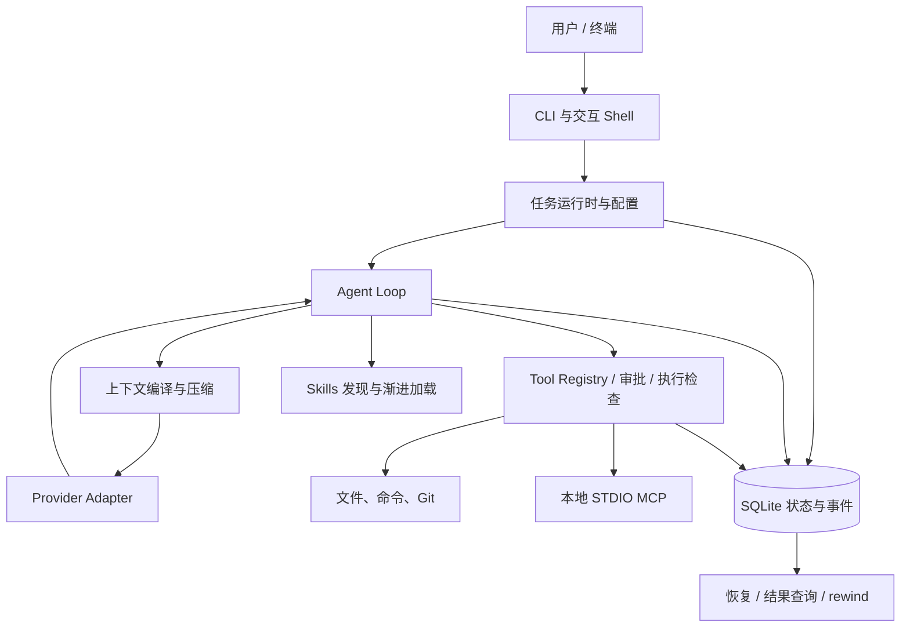

# PaiCLIPlus · Java AI Coding Agent

PaiCLIPlus 是一个用 Java 21 编写的终端 AI 编程助手。你可以在项目目录中用自然语言提出任务，让它阅读代码、定位实现、修改文件、执行命令并检查结果。

项目围绕完整的开发任务组织执行：Agent Loop 调度模型和工具，审批机制控制文件与命令操作，SQLite 记录任务进度，上下文管理支持长任务，MCP 和 Skills 提供扩展能力。

## 核心功能

- **交互式开发**：在终端提交任务，查看计划、工具调用、文件差异和执行结果。
- **工具调用与审批**：提供文件读写、代码检索、命令执行和 Git 工具，按工作区路径及审批策略控制操作。
- **模型接入**：支持 OpenAI-compatible Chat Completions、DeepSeek 和 Ollama，统一配置、凭证管理与有界重试。
- **MCP 与 Skills**：连接本地 STDIO MCP 服务；发现 Skill 元数据，按需加载正文和资源。
- **任务与会话管理**：保存 Task、Run、Tool 调用及结果，支持会话恢复、任务恢复和文件快照 rewind。
- **上下文管理**：根据预算整理模型输入，通过确定性账本压缩保留关键事实、工具关联和来源。

## 技术栈

Java 21 · Maven · Picocli · JLine · Jackson · SQLite JDBC · JavaParser · JNA · JUnit 5。

## 整体架构



一次任务通常经历：接收目标 → 创建任务并固定配置与项目指令 → 编译上下文 → 请求模型 → 审批和执行工具 → 保存结果 → 继续迭代或输出最终答复。

## 核心实现

| 设计 | 实现方式 |
| --- | --- |
| Agent Loop 与 Tool 调度 | 模型响应解析为工具调用，经 Tool Registry、参数校验和审批后执行；工具结果进入下一轮上下文 |
| 执行状态一致性 | SQLite 保存任务、调用与结果；租约和 fencing 限制过期执行者继续更新状态，恢复时检查已完成步骤 |
| 上下文压缩 | 在工具结果持久化后、下一次模型请求前，生成确定性账本与有界投影，并校验来源 |
| 扩展接入 | MCP 工具复用宿主审批链路；Skills 通过 `load_skill` 和 `read_skill_resource` 渐进加载 |
| 文件恢复 | 写入前记录快照；rewind 校验当前文件内容后恢复，避免覆盖后续手动修改 |

调用关系和协议细节见 [技术架构](docs/architecture.md)。

## 快速体验：离线 Core Demo

准备 JDK 21 和 Maven 3.9.x，在仓库根目录执行：

```powershell
mvn -DskipTests package
java -jar target/paicli-1.2.0.jar --help
java -jar target/paicli-1.2.0.jar demo core --headless
```

Core Demo 使用内置 Java 样例和确定性 Provider，无需模型 API Key。固定场景串起代码修改、测试失败后的修复、检查点中断、恢复及 rewind。运行目录位于 `~/.paicli/demo-runs/`；终端会显示状态，并在生成报告后给出 `artifacts` 路径。

演示内部使用 `mvn -o` 执行样例测试，因此本机需要 Maven 和相应依赖缓存。首次构建需要联网获取依赖，演示阶段缺少缓存时应先补齐缓存。

实现入口：[HeadlessCoreDemoRunner](src/main/java/com/paicli/demo/runtime/HeadlessCoreDemoRunner.java)；测试与验证情况见 [验证记录](docs/validation.md)。

## 接入模型并使用

完成构建后，在希望操作的项目目录启动 JAR；JAR 路径使用本机实际位置。若在 PaiCLI 仓库中体验交互模式：

```powershell
java -jar target/paicli-1.2.0.jar
```

在目标工作区创建 `.paicli/config.json`，可参考 [配置模板](examples/config.example.json)：

```json
{
  "provider": "openai",
  "provider_preset": "deepseek",
  "base_url": "https://api.deepseek.com",
  "model": "deepseek-v4-flash",
  "api_key_env": "DEEPSEEK_API_KEY",
  "credential_ref": "PaiCLI/provider/deepseek/default",
  "approval_mode": "on-request"
}
```

按服务账号可用的模型调整 `model`。配置依次由默认值、用户级 `~/.paicli/config.json`、工作区配置、CLI/会话设置覆盖。

通过环境变量 `DEEPSEEK_API_KEY` 提供凭证；Windows 也可在终端使用 `/provider login` 隐藏输入并保存到 Credential Manager。配置文件只保存凭证引用。

典型操作：

1. 用 `/doctor`、`/provider status` 检查环境，再用 `/provider test` 检查模型连接。
2. 输入：“阅读 README 和主要入口，说明这个项目的调用链。”
3. 提交一个具体修改任务，按提示审批文件写入和命令执行。
4. 用 `/tasks`、`/report latest` 查看结果；`/help` 查看全部命令。

`/resume` 绑定保存的会话，`/task recover` 恢复任务执行，`/rewind` 恢复受管理的文件快照。真实 Provider 调用可能产生费用。

## 源码导航

| 关注点 | 入口 |
| --- | --- |
| Agent Loop 与工具 | [AgentLoop](src/main/java/com/paicli/agent/AgentLoop.java)、[tool](src/main/java/com/paicli/tool) |
| 交互层与任务绑定 | [InteractiveRuntimeAdapter](src/main/java/com/paicli/interactive/runtime/InteractiveRuntimeAdapter.java)、[ProductionInteractiveTaskExecutor](src/main/java/com/paicli/interactive/runtime/ProductionInteractiveTaskExecutor.java) |
| 模型与凭证 | [provider](src/main/java/com/paicli/provider)、[credential](src/main/java/com/paicli/credential) |
| 审批、执行与状态 | [safety](src/main/java/com/paicli/safety)、[runtime](src/main/java/com/paicli/runtime)、[state](src/main/java/com/paicli/state) |
| 上下文压缩 | [CompactionCoordinator](src/main/java/com/paicli/context/CompactionCoordinator.java)、[DeterministicCompactionPolicy](src/main/java/com/paicli/context/DeterministicCompactionPolicy.java) |
| MCP 与 Skills | [mcp](src/main/java/com/paicli/mcp)、[SkillRuntime](src/main/java/com/paicli/skill/SkillRuntime.java) |
| 离线演示 | [demo](src/main/java/com/paicli/demo)、[内置 Java 样例](src/main/resources/demo-fixtures/core-java-demo) |

```text
src/main/           运行时、资源和内置演示
src/test/           单元测试、集成测试与测试资源
src/dist/           Windows / Unix 启动器
src/assembly/       Maven 分发包描述
benchmarks/coding/  合成编码任务与 Maven 模板
scripts/uat/        Windows 终端验收工具
examples/           配置示例
docs/               技术架构与验证记录
```

`mvn package` 会生成 JAR 及 `target/dist/` 下的分发目录、ZIP。解压后可使用 `bin/paicli.ps1`、`bin/paicli.cmd` 或 `bin/paicli`。例如 Windows 分发版的演示命令为 `./bin/paicli.ps1 demo core --headless`。详见 [分发包说明](src/dist/README.md)。

## 测试与使用注意

```powershell
mvn test
mvn verify -Pintegration
```

已完成主代码和测试源码编译，以及 85 项关键测试。各测试组的环境条件、具体命令和执行范围见 [验证记录](docs/validation.md)。

- 模型当前按完整响应处理，终端显示执行进度，不提供模型逐 token 输出。
- MCP 使用本地 STDIO 服务；Skills 加载内容后，脚本仍通过宿主命令工具和审批执行。
- 恢复会检查持久化状态，无法确认的外部副作用需要人工处置；rewind 只覆盖已记录的文件快照。
- Windows 提供 Credential Manager 集成；其他平台的凭证方式和终端行为见 [技术架构](docs/architecture.md)。

[第三方与许可证说明](THIRD_PARTY_NOTICES.md)
